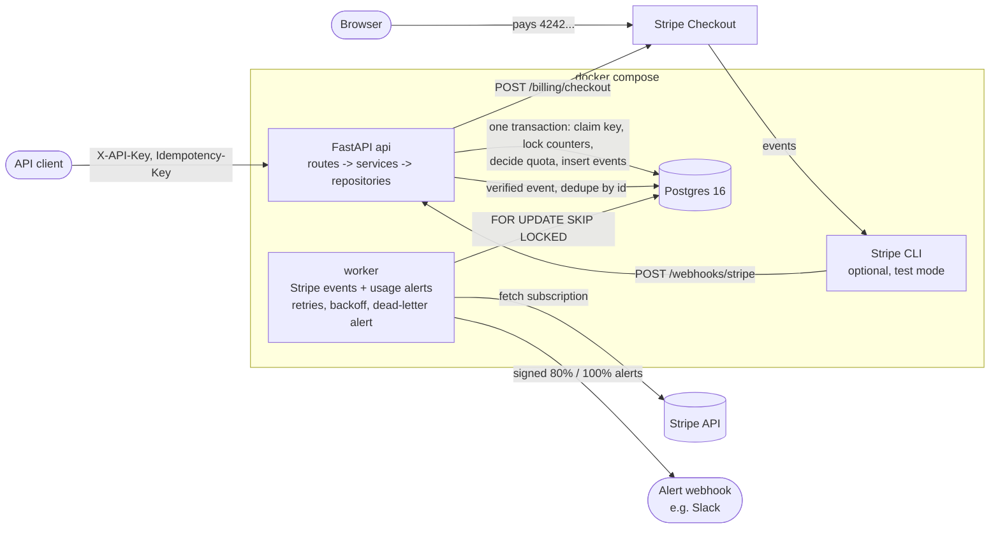

# Usage Metering & Billing Engine

[](https://github.com/kwibuloy/Flyrank_UsageMetering_Capstone/actions/workflows/ci.yml)

A multi-tenant backend that meters API calls and AI tokens exactly once, enforces monthly plan quotas, prices usage with exact integer money math, and sells a Pro plan through Stripe Checkout (test mode), with plan changes driven only by verified webhooks.

FlyRank backend capstone. Every requirement has captured proof in [EVIDENCE.md](EVIDENCE.md); design decisions live in [docs/](docs/README.md).

## What it does
- **Idempotent metering.** `POST /generate` with an `Idempotency-Key` records usage once. Retries and concurrent duplicates get the stored response back byte-for-byte (`Idempotent-Replayed: true`); the same key with a different body is `409`.
- **Quotas.** Usage is checked against the tenant's plan inside the same transaction, with the counter rows locked, so concurrent requests can never oversell a quota.
- **402 vs 429.** `402 payment_required` when paying fixes it (Free plan exhausted, subscription past due); `429 quota_exceeded` + `Retry-After` when only waiting fixes it (Pro exhausted until the month resets).
- **Cost.** Integer micro-USD. Cached input, fresh input, output and reasoning tokens are priced separately from pinned constants in [config/pricing.toml](config/pricing.toml), summed exactly and rounded once.
- **Stripe.** Checkout in test mode; webhooks are signature-checked, de-duplicated by event id, and applied by a background worker with retries, backoff and a dead-event alert.
- **Usage on the Stripe invoice.** Each Pro request's exact cost is reported to a Stripe Billing Meter from a transactional outbox, so the invoice shows the flat fee plus metered usage and matches `GET /usage` to the cent. Quotas and 402/429 are unchanged.
- **Usage alerts (stretch).** When a tenant reaches 80% and 100% of a monthly limit, exactly one alert per threshold is queued in the same transaction as the usage and delivered by the worker to a signed webhook (Slack-compatible) or the log, with retries. Tenants see them at `GET /alerts`.

## Plans
| Plan | API calls / month | AI tokens / month | When exhausted |
|---|---:|---:|---|
| Free | 1,000 | 100,000 | `402` with an upgrade link |
| Pro | 50,000 | 5,000,000 | `429` + `Retry-After` (seconds to next month, UTC) |

A request is allowed only if it fits entirely: `used + requested <= limit` for every metric. The 1,000th call is allowed and the 1,001st is rejected. AI tokens = input + output + reasoning; cached tokens are part of input and are not counted twice.

## Pricing (pinned, version `2026-11-01`)
| Item | Price |
|---|---|
| API call | $0.0005 each (500 µ$) |
| Fresh input tokens | $1.25 / 1M |
| Cached input tokens | $0.3125 / 1M |
| Output + reasoning tokens | $10.00 / 1M |

Example: 10,000 input (4,000 cached), 2,000 output, 500 reasoning = 7,500 + 1,250 + 25,000 = **33,750 µ$** ($0.03). Full rules and worked examples: [docs/pricing.md](docs/pricing.md).

## Architecture

- **Layers:** `app/api` (HTTP only) → `app/services` (rules; `quota.py` and `pricing.py` are pure) → `app/repositories` (SQL, always scoped by `tenant_id`). See [docs/architecture.md](docs/architecture.md).
- **Write path:** [docs/idempotency.md](docs/idempotency.md) · **quota rules:** [docs/quotas.md](docs/quotas.md) · **Stripe:** [docs/stripe.md](docs/stripe.md) · **worker:** [docs/background-jobs.md](docs/background-jobs.md) · **tables:** [docs/data-model.md](docs/data-model.md).

## Run it
Requirements: Docker Desktop (or Docker Engine with Compose v2). Nothing else is needed on the host.

```bash
cp .env.example .env               # Stripe values are only needed for Checkout/webhooks
docker compose up -d --build       # db, api (runs migrations on start), worker
docker compose exec api python scripts/seed.py
curl localhost:8000/health
```

The seed creates two demo tenants (local database only, not secrets):

| Tenant | Plan | X-API-Key |
|---|---|---|
| acme | Free | `demo_free_acme_key` |
| globex | Pro | `demo_pro_globex_key` |

Try it:
```bash
curl -X POST localhost:8000/generate \
  -H "X-API-Key: demo_free_acme_key" -H "Idempotency-Key: demo-1" \
  -H "Content-Type: application/json" \
  -d '{"input_tokens":10000,"cached_input_tokens":4000,"output_tokens":2000,"reasoning_tokens":500}'
curl localhost:8000/usage -H "X-API-Key: demo_free_acme_key"
```
Interactive API docs: http://localhost:8000/docs

### Stripe (test mode, optional)
1. In the Stripe dashboard (test mode / sandbox) create a product "Pro" with a monthly recurring price.
2. In `.env` set `STRIPE_SECRET_KEY` (`sk_test_…`) and `STRIPE_PRO_PRICE_ID` (`price_…`).
3. Get the webhook secret and start forwarding (the Stripe CLI runs in Docker; no install, no tunnel):
   ```bash
   docker compose run --rm stripe listen --print-secret
   ```
   Put the printed `whsec_…` into `.env` as `STRIPE_WEBHOOK_SECRET`, then:
   ```bash
   docker compose up -d --force-recreate api worker
   docker compose --profile stripe up -d
   ```
4. Optional, usage on the invoice: create the Billing Meter and the metered usage price once (idempotent, test mode):
   ```bash
   docker compose exec api python scripts/stripe_setup_metering.py
   ```
5. `POST /billing/checkout` with a Free tenant's key, open the returned URL and pay with `4242 4242 4242 4242`. Within seconds `GET /usage` shows `plan: pro` and the Pro limits (and `usage_billing.enabled: true` if step 4 was done).

Details and troubleshooting: [docs/stripe.md](docs/stripe.md).

### Usage alerts (optional webhook)
Alerts work with no setup: the worker writes them to its log (`docker compose logs worker | grep USAGE_ALERT`). To receive them over HTTP, set `ALERT_WEBHOOK_URL` in `.env` (a Slack incoming webhook works as-is) and optionally `ALERT_WEBHOOK_SECRET` to sign each POST (`X-Alert-Signature: t=…,v1=<HMAC-SHA256>`), then `docker compose up -d --force-recreate worker`. Details: [docs/background-jobs.md](docs/background-jobs.md#usage-alerts-stretch-goal-built).

## Endpoints
| Method | Path | Auth | Purpose |
|---|---|---|---|
| `GET` | `/health` | none | Liveness + database check |
| `POST` | `/generate` | `X-API-Key`, `Idempotency-Key` | Simulated AI call; meters 1 API call + tokens; returns its cost |
| `GET` | `/usage` | `X-API-Key` | This month's usage, limits, remaining, and cost rollup |
| `GET` | `/alerts` | `X-API-Key` | This month's 80% / 100% usage alerts and their delivery status |
| `POST` | `/billing/checkout` | `X-API-Key` | Stripe Checkout URL for the Pro plan |
| `GET` | `/billing/success`, `/billing/cancel` | none | Checkout redirect pages (display only) |
| `POST` | `/webhooks/stripe` | `Stripe-Signature` | Verified Stripe events, queued for the worker |

Every error uses one envelope: `{"error": {"code", "message", "details"}}`. Full contract: [docs/api.md](docs/api.md).

## Test it
```bash
docker compose exec api pytest -q                       # unit + integration (real Postgres)
docker compose exec api python scripts/probes.py        # acceptance probes P1, P2, P4, P5 + alerts A1
docker compose exec api python -u scripts/probes.py --only P3   # live Checkout: pay in the browser
docker compose exec api python -u scripts/probes.py --only B1   # usage on a real Stripe invoice preview
docker compose exec api python scripts/loadtest.py --tenants 100 --requests 5000 --concurrency 50
```
Integration tests run against a separate `billing_test` database created by the compose Postgres on first start. CI ([.github/workflows/ci.yml](.github/workflows/ci.yml)) runs lint, the full suite with migration checks, and this README's Docker flow with the probes on every push.

The load test creates throwaway tenants, fires unique requests round-robin, and then verifies from Postgres that accepted requests == usage events and counters == `SUM(events)` for every tenant. On Docker Desktop (16 vCPU), 100 tenants and 50 concurrent clients: 1 API process 51 req/s → 4 processes (default) 149 req/s, p95 473 ms, 0 errors. Scaling notes: [docs/architecture.md](docs/architecture.md#scaling).

## Limitations (honest)
- **Operator alerts go to logs.** A dead Stripe event or undeliverable usage alert logs `ALERT …`; there is no pager integration.
- **Usage alerts use one webhook for all tenants** (an operator channel), and delivery is at-least-once (receivers de-duplicate on `alert_id`). Per-tenant endpoints and email are not built.
- **Usage billing covers Pro only, one meter event per request.** Free usage is never charged. High volume would need per-customer batching (one Stripe call per request today). Subscriptions created before the usage price existed stay flat-fee until they are changed in Stripe.
- **One price book per period.** Events do not store the pricing version, so changing `pricing.toml` mid-month re-prices the whole month. Fine for a pinned config; a real system would version prices per event.
- **Local webhooks depend on the Stripe CLI.** While the CLI reconnects it does not forward events (`stripe events resend` redelivers them). Production would use a dashboard webhook endpoint.
- **Plan changes apply immediately.** Downgrading mid-month keeps the month's usage, so a tenant over the Free limits is blocked until next month. No proration logic beyond what Stripe does.
- **Tenants are created only by the seed script.** No signup, API key rotation or admin endpoints.
- **Idempotency keys are kept forever.** A 30-day retention policy is documented but not enforced.
